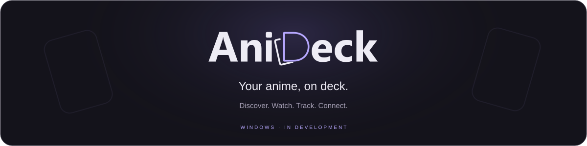

  

  <a href="https://github.com/Machoist/anideck/releases"><strong>Downloads</strong></a> &nbsp;·&nbsp;
  <a href="#getting-started">Getting started</a> &nbsp;·&nbsp;
  <a href="https://github.com/Machoist/anideck/issues">Feedback</a> &nbsp;·&nbsp;
  <a href="https://ko-fi.com/machorp">Support AniDeck</a>

AniDeck brings anime discovery, watching, tracking, and friends together in one Windows app. Build a home screen around your watching habits, keep your lists in sync, and find your next watch with your circle.

> **In development.** A public installer has not been released yet. Downloads will appear on the [Releases page](https://github.com/Machoist/anideck/releases) when ready. Experimental [Mac test builds](docs/MAC-TESTING.md) are being prepared for Intel and Apple Silicon.

## On your deck

| Feature | What it brings |
| :--- | :--- |
| **Make Home yours** | Arrange decks and widgets for your queue, tonight’s picks, quick logging, and shows you’re almost finished with. |
| **Keep your place** | Connect AniList or Kitsu to manage lists and track episode progress. |
| **Find the next one** | Explore titles, browse discovery shelves, or let shuffle choose a watch. |
| **Settle in** | Use subtitles, episode navigation, playback controls, and compatible TV playback from your PC. |
| **Bring your friends** | Message your circle, share anime cards, compare tastes, and agree on your next watch. |
| **Connect your library** | Add Jellyfin if you use it. Your own media server is optional. |

## Getting started

Once the Windows app is available:

1. **Connect your list.** Open Settings → Account and sign in with AniList or Kitsu.
2. **Arrange your deck.** Choose the Home widgets and collections you want close by.
3. **Find your people.** Open Friends, choose a handle, and add someone by handle or friend code.
4. **Start watching.** Pick a title, choose an available source, and continue where you left off.

The installed app will not require Node.js, terminal commands, or your own backend.

### Watching on TV

Open Settings → TV and follow the connection steps in your TV’s browser. Keep the PC and TV on the same network. Compatible playback can be controlled from AniDeck on the PC; browser and codec support vary by device.

### Making watch plans

Share a title and time with a friend. They can accept, decline, or suggest another time. Watch invitations save a shared plan; synchronized watch parties are not included yet.

## Privacy and connected services

AniDeck profiles are optional. You choose who can see your watcher card, and only accepted friends can message you. Social profiles and messages are stored by AniDeck; messages are not end-to-end encrypted. Desktop message alerts are optional.

Anime information, artwork, and streaming sources come from connected services and third-party providers. Availability depends on those services. Jellyfin playback uses the library you connect.

## Feedback and support

Found a bug or have an idea? [Open an issue](https://github.com/Machoist/anideck/issues) and describe what happened, what you expected, and your app version. Keep passwords, tokens, and private server addresses out of reports.

If you’d like to support development, you can [support AniDeck on Ko-fi](https://ko-fi.com/machorp).

---

  <a href="docs/DEVELOPMENT.md">Build from source</a> &nbsp;·&nbsp;
  <a href="server/README.md">Self-hosting</a> &nbsp;·&nbsp;
  <a href="THIRD_PARTY_NOTICES.md">Third-party notices</a>

