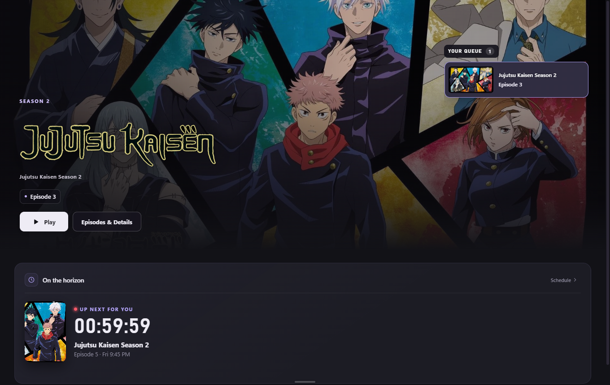
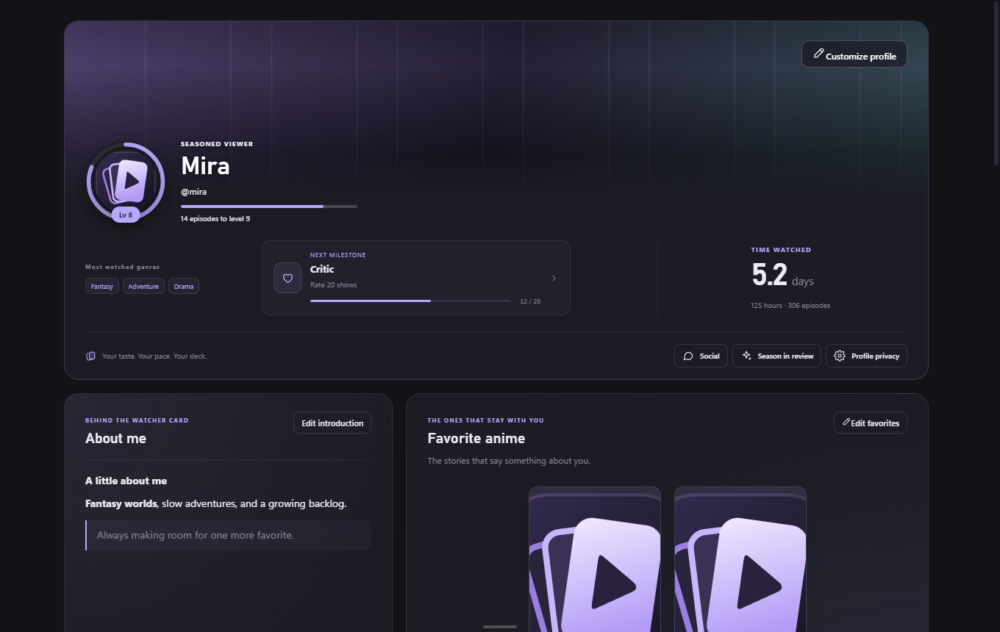
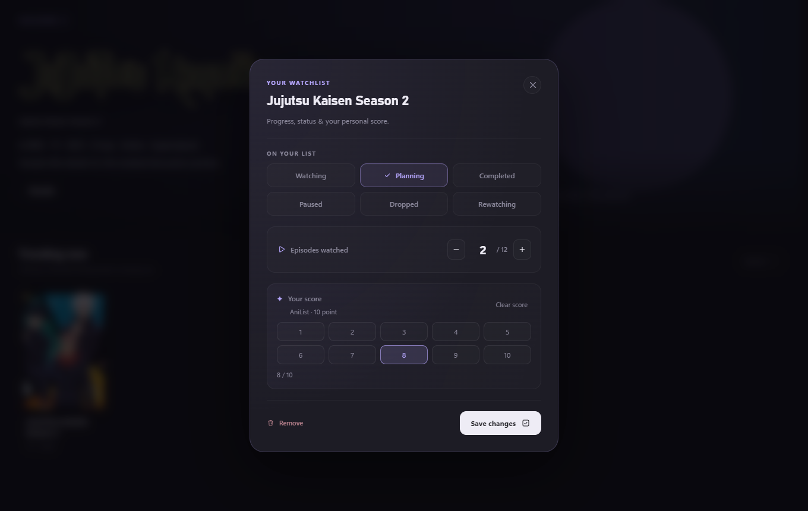
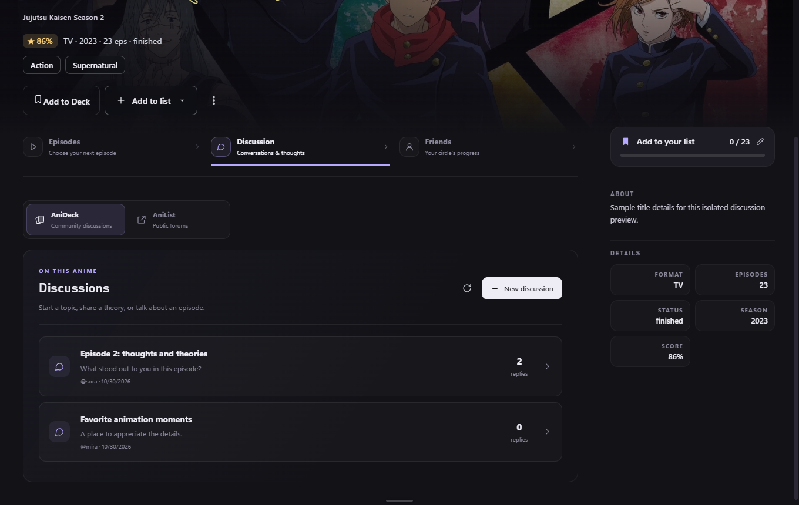
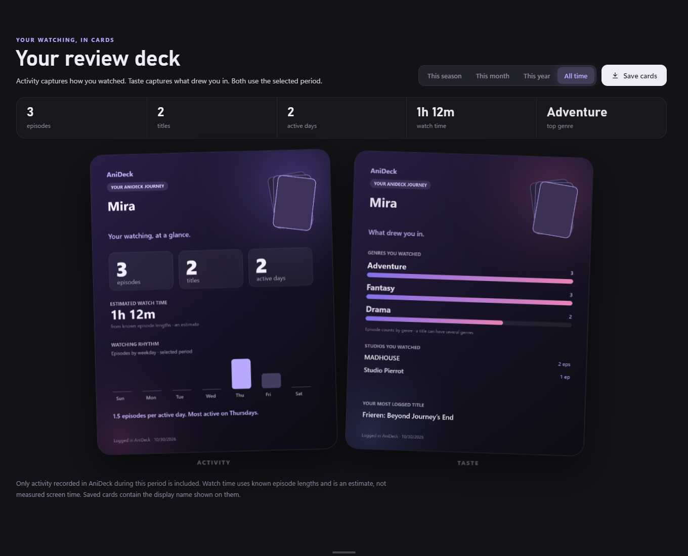

  

  <strong>A home for your next watch—and the people you share it with.</strong>

  <a href="https://github.com/Machoist/anideck/releases">Releases</a> &nbsp;·&nbsp;
  <a href="https://ko-fi.com/machorp">Support on Ko-fi</a> &nbsp;·&nbsp;
  <a href="https://github.com/Machoist/anideck/issues">Feedback</a>

AniDeck brings anime discovery, playback, tracking, and conversation into one desktop app. Pick up your queue, find something new, shape a profile around your favorites, and plan a watch with your circle.

**Windows preview · In active development · AniList & Kitsu · Optional local tracking**

## Get AniDeck

AniDeck is currently in testing. **There is no public release installer yet.** Public downloads will appear on the [Releases page](https://github.com/Machoist/anideck/releases).

| Platform | Availability |
| :--- | :--- |
| **Windows · x64** | Primary desktop target. Preview installers are available through successful [Windows build workflow runs](https://github.com/Machoist/anideck/actions/workflows/check.yml). GitHub sign-in is required to download Actions artifacts. |
| **macOS · Apple Silicon & Intel** | Experimental test builds. Physical Mac verification is still pending; see [Mac testing](docs/MAC-TESTING.md). |

Installed builds do not require Node.js, terminal commands, or a self-hosted backend. When a public update is available, AniDeck can point you to its GitHub release.

## A look inside

  

Home keeps your next episode and upcoming shows close by.

| Your profile | Your watchlist |
| :---: | :---: |
|  |  |
| A place for your favorites, introduction, and watching milestones. | Progress, status, and ratings in one place. |

<strong>More: discussions and review cards</strong>

Captured from the desktop app with an isolated demo profile and sample data. Screens are previews; availability and artwork depend on connected services. Anime artwork belongs to its respective owners.

## Make it your deck

| Discover & settle in | Keep it personal |
| :--- | :--- |
| **A Home that fits you.** Arrange widgets for your queue, tonight’s picks, upcoming episodes, and your backlog. | **Tracking your way.** Keep a list on this device, or connect AniList or Kitsu for progress, status, and rating sync. |
| **Find the next one.** Explore discovery shelves, browse titles, or let Deal me a show choose from your planning list. | **A profile with personality.** Add a picture, banner, formatted About me, timezone, and up to eight favorite anime. |
| **A focused player.** Episode navigation, subtitles, playback controls, and compatible browser-based TV playback. | **Your watching, in cards.** Explore your activity, genres, milestones, and shareable review cards. |
| **Your own library.** Connect an optional Jellyfin server in Settings → Account. Its media stays separate from anime discovery and Social. | **Your people, on deck.** Send messages, share titles, compare tastes, and make watch plans. Title discussions have separate topics and replies. |

### Start in a few steps

1. **Choose your tracker.** Connect AniList or Kitsu, or continue with a device-only list.
2. **Create your AniDeck profile.** Choose a handle, sign in with your existing private key, or skip for now.
3. **Make Home yours.** Arrange your widgets and pick a title. Episodes appear when a streaming source returns a matching episode list.
4. **Find your circle.** Open Social to add friends, send a message, or share a watch plan.

### Bring your list with you

In **Settings → Account**, review your local list before sending selected titles to AniList or Kitsu. The review distinguishes new entries from existing entries and eligible progress updates. Your local list is retained; existing destination entries are not blindly replaced.

### Keep the conversation going

AniDeck discussions use your AniDeck profile. Public AniList forums are also readable; AniList sign-in is required for replying or liking there. Social supports friends and message requests subject to the recipient’s privacy setting. Accepting a message request opens chat without automatically adding a friend.

Watch plans let someone accept, decline, or suggest a time. They are shared plans; synchronized watch parties are not included.

## Accounts & privacy

- **An AniDeck profile is optional.** Local watching and tracking remain available without one.
- **Your private key signs you in on another device.** Keep it safe. It restores your AniDeck identity; a local watchlist remains on its original device.
- **Profile details and watcher-card sharing are separate.** Your introduction and favorite shelf are visible to people opening your profile; watcher-card visibility has its own controls.
- **Messages are stored by AniDeck and are not end-to-end encrypted.** Recipient privacy settings control message requests. Desktop alerts are optional.
- **Jellyfin stays in its own library.** Private library titles do not feed global anime search, recommendations, or friends’ activity.

Metadata, artwork, subtitles, and streaming availability depend on external services. AniDeck is not affiliated with AniList, Kitsu, Jellyfin, or the third-party streaming providers. A catalog listing does not guarantee a playable stream. Use media only where you have the right to access it.

## Help shape the next chapter

[Report a bug or suggest an improvement](https://github.com/Machoist/anideck/issues). Include your app version, the steps to reproduce, and what you expected. Remove private keys, tokens, and server addresses from screenshots and reports.

For local setup and contribution checks, start with the [development guide](docs/DEVELOPMENT.md). The [worklist](WORKLIST.md) records completed work and remaining verification. The package is marked `UNLICENSED`; this repository does not currently grant a reuse license.

If you would like to support development, [support AniDeck on Ko-fi](https://ko-fi.com/machorp).

---

  <a href="docs/DEVELOPMENT.md">Development</a> &nbsp;·&nbsp;
  <a href="docs/MAC-TESTING.md">Mac testing</a> &nbsp;·&nbsp;
  <a href="server/README.md">Self-hosting</a> &nbsp;·&nbsp;
  <a href="THIRD_PARTY_NOTICES.md">Third-party notices</a>

